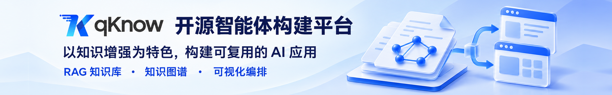

 
 
 
 
 
 
 
 

  <a href="README.md">📖简体中文</a> | 📖English

## Overview

**Build reusable AI applications with your own knowledge and tools.**

**qKnow is an open-source AI agent platform built around knowledge augmentation.** It combines knowledge bases, knowledge graphs, and visual orchestration to help developers build, configure, and reuse AI applications powered by business knowledge and tools.

Organize manuals, policies, and business data into knowledge bases and knowledge graphs. Connect models, knowledge, and tools on a visual canvas to build Bots, then bind each team's knowledge resources to create ready-to-use applications.

✨✨✨**Documentation**✨✨✨ <a href="https://community.qknow.ai" target="_blank">https://community.qknow.ai</a>

✨✨✨**Open-Source Edition Demo**✨✨✨ <a href="https://demo.qknow.ai" target="_blank">https://demo.qknow.ai</a> — Username: `qKnow` Password: `qKnow123`

✨✨✨**Professional Edition Demo**✨✨✨ <a href="https://pro-demo.qknow.ai" target="_blank">https://pro-demo.qknow.ai</a> — [Contact us for demo credentials](https://community.qknow.ai/business/policy.html).

> If you find qKnow useful, give us a **Star ⭐️**! Your support keeps us building and improving. 🚀

License: Apache License 2.0 with additional qKnow terms. See [LICENSE](LICENSE) and [License and Commercial Services](#license-and-services).

## Key Highlights

### Knowledge augmentation: Ground answers in documents and business relationships

Product manuals work well with passage-based retrieval, while questions such as "Which modules does this product include, and who is responsible for each?" benefit from a knowledge graph. qKnow supports building knowledge bases from documents for retrieval-augmented generation (RAG), as well as extracting entities and relationships from text or databases. When asking knowledge-based questions, you can select the relevant knowledge bases and graphs to ground the answers.

If an answer misses a policy, run a **retrieval test** with the same question to see which source passages were retrieved. Then switch between full-text, vector, or hybrid search, and adjust the number of returned passages (Top-K) and the similarity threshold. Click a citation in an answer to jump to the corresponding source passage.

### Visual orchestration: Connect knowledge, tools, and MCP services in one Bot

Create a Workflow, Chatflow, or Agent in the AI Workspace, then drag and connect model, knowledge, tool, and logic nodes to build business workflows. Connect MCP services, use built-in tools, or call existing business APIs so your Bot can answer questions with knowledge and complete tasks with tools. For example, a product support Bot can search product manuals, use a ticket lookup tool to check progress, and have the model combine the results into a complete response—bringing knowledge-based answers and business queries together in one flow. Before publishing, test with real questions, preview responses in real time, and inspect execution results to verify each step and bring business ideas to life faster.

### Application reuse: Turn one Bot into multiple business applications

A Bot defines how a task is performed; an application instance determines which Bot and knowledge resources to use. Select the prebuilt Knowledge Q&A application in the Application Center, bind a knowledge base and a compatible Bot, and name the instance. It is then ready to use from My Applications. Two teams can share the same Q&A logic while using their own materials. If one team needs a different workflow, duplicate the prebuilt Bot, modify and test it, then bind the updated Bot to that team's instance.

## Quick Start

### Try It Online

Visit the [qKnow Open-Source Edition Demo](https://demo.qknow.ai/) to explore the platform without installing anything.

**Username: `qKnow`　Password: `qKnow123`**

After signing in, open the Application Center to explore the Knowledge Q&A application and its associated resources. Then visit the AI Workspace to view Bot types and their orchestration workflows.

### Choose a Deployment Method

- **[Docker Compose Deployment](https://community.qknow.ai/docs/deploy/docker-compose-deployment.html)**: Follow the guide to configure and start a local environment for quick evaluation and deployment.
- **[Run from Source](https://community.qknow.ai/docs/deploy/manual-deployment/)**: Set up the backend and frontend development environments to customize and extend the platform.

## Product Architecture

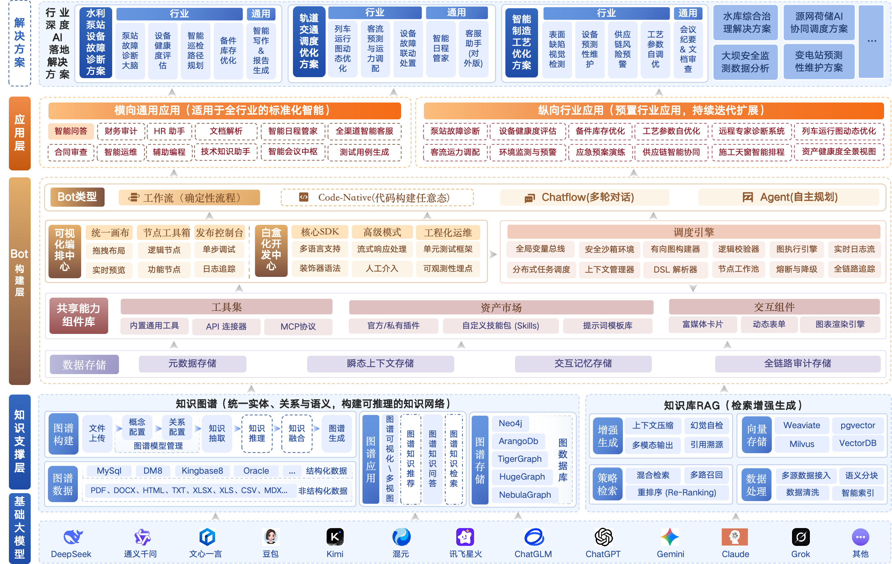

## Screenshots

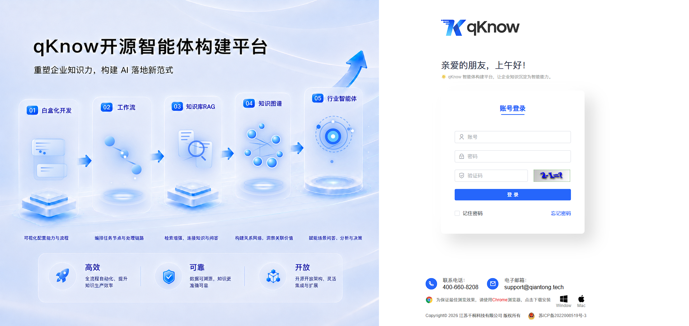

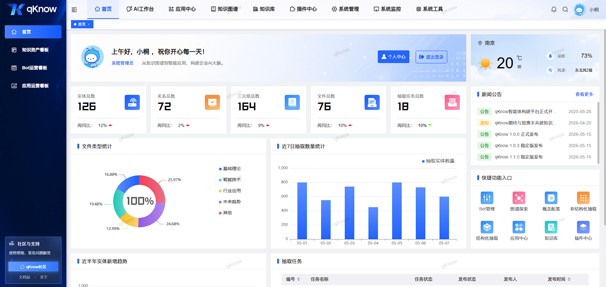

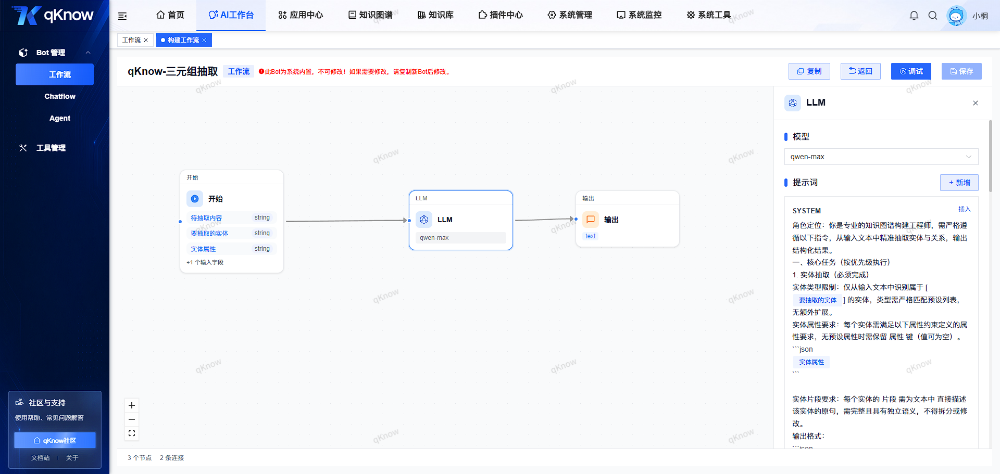

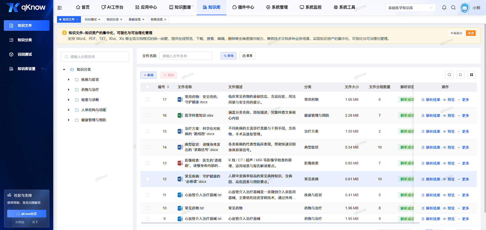

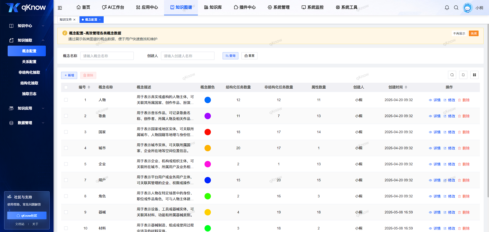

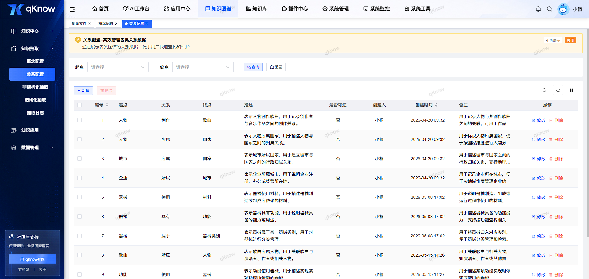

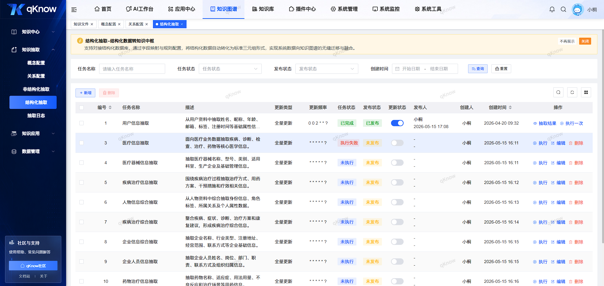

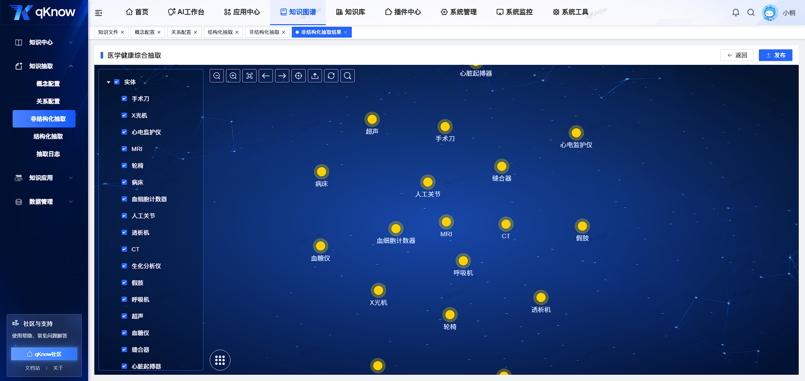

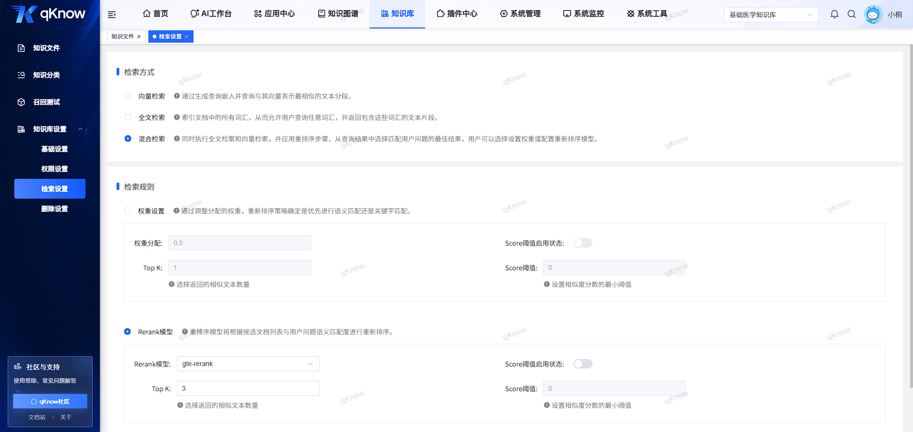

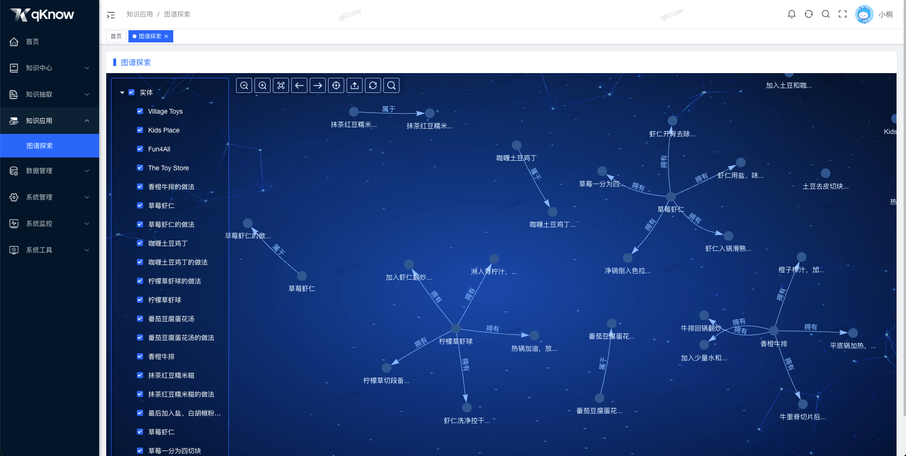

## Core Features

| Module | Description |
| --- | --- |
| Model Integration | Configure and manage large language model services in one place. Integrate different model providers through Spring AI to power agents and applications. |
| Bot Management | Create, edit, duplicate, publish, debug, and manage the runtime status of Bots. |
| Visual Orchestration Center | Build business agents by orchestrating Workflows, Chatflows, and Agents on a drag-and-drop canvas. |
| Asset Center | Centrally manage tools, MCP services, plugins, prompts, knowledge components, and reusable agent assets. |
| Application Center | Browse, access, and manage built-in and user-created applications in one place. |
| Application Configuration | Bind knowledge bases, knowledge graphs, Bots, and parameter settings to create tailored applications. |
| Knowledge Q&A | A unified application plugin architecture enables standardized integration, independent extension, and centralized management of Knowledge Q&A and future AI applications. |
| Knowledge Center | Classify and manage documents, reference materials, and knowledge assets to consolidate and organize enterprise knowledge. |
| Concept Configuration | Define custom entities, concepts, and extraction rules to establish a standardized concept system for knowledge graph construction. |
| Relationship Configuration | Configure relationship types and extraction rules between concepts to model connections across knowledge. |
| Unstructured Data Extraction | Automatically extract entities, relationships, and triples from unstructured content such as documents and text. |
| Structured Data Extraction | Extract knowledge elements from structured sources such as databases and tables to build knowledge graphs. |
| Graph Visualization | Explore knowledge graphs through visual browsing, relationship tracing, intelligent search, and interactive analysis. |
| Knowledge Base Management | Create, configure, update, and manage knowledge bases to support RAG-based Q&A and semantic search. |
| File Parsing | Parse multiple file formats, clean text, split content, and generate semantic chunks. |
| Retrieval Testing | Test knowledge chunk retrieval with simulated user questions and fine-tune retrieval parameters. |

> Note: Core features will continue to evolve with each release. More AI applications, industry plugins, and knowledge augmentation capabilities will be introduced through the unified plugin architecture. Community contributions are welcome.

## Development and Extension

qKnow uses a decoupled frontend and backend with a modular design, making it easier for developers to understand the codebase, integrate business systems, and extend functionality.

| Layer | Technologies |
| --- | --- |
| Backend | JDK 17, Spring Boot 3, Spring Security, MyBatis-Plus, Spring AI |
| Frontend | Vue 3, Element Plus, Vite |
| Storage and Caching | MySQL, Redis, Neo4j, Weaviate |

For source-based development setup, see the [Backend Setup Guide](https://community.qknow.ai/docs/deploy/manual-deployment/system.html) and [Frontend Setup Guide](https://community.qknow.ai/docs/deploy/manual-deployment/vue.html).

## QQ Community

Join the official qKnow QQ group for the latest updates, technical support, and community discussions. **👉 <a href="https://community.qknow.ai/discuss.html">Join the QQ Group</a>**

## License and Commercial Services

qKnow is provided under the **Apache License 2.0 with additional project terms** and supports commercial use. You must comply with [LICENSE](LICENSE) and retain the logos, copyright notices, license notices, and attribution it requires.

An appropriate commercial license is required to remove or modify these identifiers, white-label the platform, offer it as an OEM solution, or repackage it as another product. For brand customization licensing, the Professional Edition, and technical services, see [Commercial Cooperation](https://community.qknow.ai/business/policy.html).
