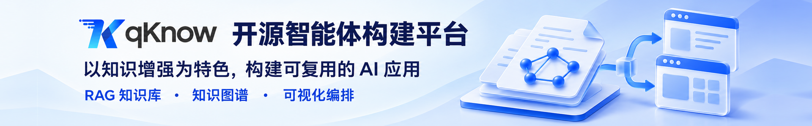

 
 
 
 
 
 
 

  📖简体中文 | <a href="README.en.md">📖English</a>

## 平台简介

**用自己的知识和工具，构建可复用的 AI 应用。**

**qKnow 是一款以知识增强为特色的开源智能体构建平台。** 融合知识库、知识图谱与可视化编排，帮助开发者基于业务知识和工具能力，构建、配置和复用 AI 应用。

你可以把手册、制度和业务数据整理成知识库与知识图谱，在画布上把模型、知识和工具编排成 Bot，再为不同团队绑定各自的知识资源，生成可以直接使用的应用。

✨✨✨**在线文档**✨✨✨ <a href="https://community.qknow.ai" target="_blank">https://community.qknow.ai</a>

✨✨✨**开源版演示地址**✨✨✨ <a href="https://demo.qknow.ai" target="_blank">https://demo.qknow.ai</a> ，账号：`qKnow` 密码：`qKnow123`

✨✨✨**专业版演示地址**✨✨✨ <a href="https://pro-demo.qknow.ai" target="_blank">https://pro-demo.qknow.ai</a> ，演示账号请 [联系客服获取](https://community.qknow.ai/business/policy.html)

> 如果 qKnow 对您有帮助，请点个 **Star ⭐️**，这是我们持续更新的最大动力！ 🚀

许可：Apache License 2.0 及 qData 附加条件，详见 [LICENSE](LICENSE) 与[商用说明](#license-and-services)。

## 核心特点

### 知识增强，让回答用上文档和业务关系

产品手册适合按段检索，“产品包含哪些模块、每个模块由谁负责”则适合用图谱表达。qKnow 支持从文档构建用于检索增强生成（RAG）的知识库，也支持从文本或数据库抽取实体和关系。发起知识问答时，可以选择相关知识库与图谱作为回答依据。

如果回答漏掉了一条规定，可以先用同一个问题做**召回测试**，查看命中了哪些原文段落，再切换全文、向量或混合检索，调整返回段落数（Top-K）和相似度阈值。在问答结果中，点击引用即可回到对应的原文段落。

### 可视化编排，把知识和工具接入同一个 Bot

在 AI 工作台创建工作流（Workflow）、对话流（Chatflow）或 Agent，通过画布连接模型、知识、工具和逻辑节点。例如，产品支持 Bot 可以用知识节点检索手册。如果团队已有工单查询接口，还可以通过工具节点查询处理进度，交给模型整理答复。工具连接器和提示词模板可以复用。发布前，先用实际问题在线调试，查看运行结果。

### 应用复用，一套 Bot 可以生成多个业务应用

Bot 定义“这个任务怎么做”，应用实例决定“这次用哪个 Bot、读哪份资料”。在应用中心选择预置的知识问答应用，绑定知识库和适配的 Bot，为实例命名后，就能从「我的应用」进入使用。两个团队可以沿用同一套问答逻辑，分别使用自己的资料。如果其中一个团队需要调整流程，可以复制预置 Bot、修改调试后，再换绑到对应实例。

## 快速开始

### 在线体验

访问 [qKnow 开源版演示环境](https://demo.qknow.ai/)，无需安装即可了解产品。

**账号：`qKnow`　密码：`qKnow123`**

登录开源演示，进入「应用中心」查看知识问答的详情和关联资源，再到「AI 工作台」查看 Bot 的类型与编排流程。

### 选择部署方式

- **[Docker Compose 部署](https://community.qknow.ai/docs/deploy/docker-compose-deployment.html)**：按文档配置并启动本地环境，适合快速体验与部署。
- **[源码启动](https://community.qknow.ai/docs/deploy/manual-deployment/)**：启动前后端开发环境，开展二次开发与功能扩展。

## 产品功能架构

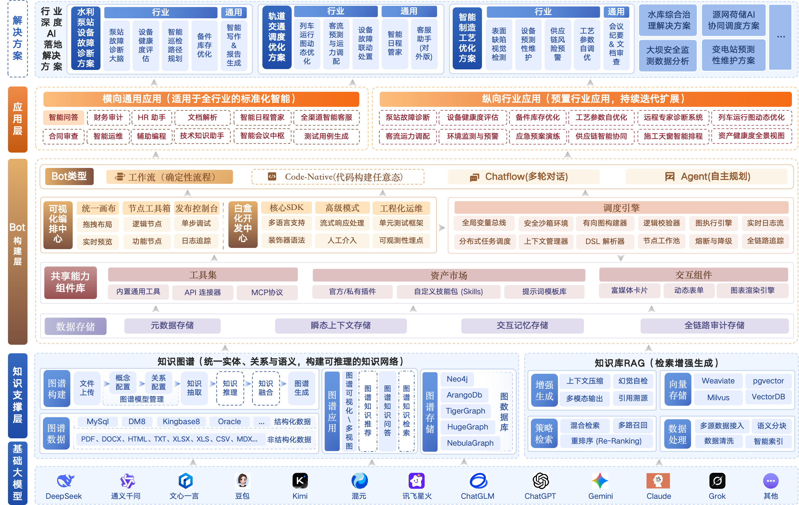

## 系统配图

<table>
    <tr>
        <td>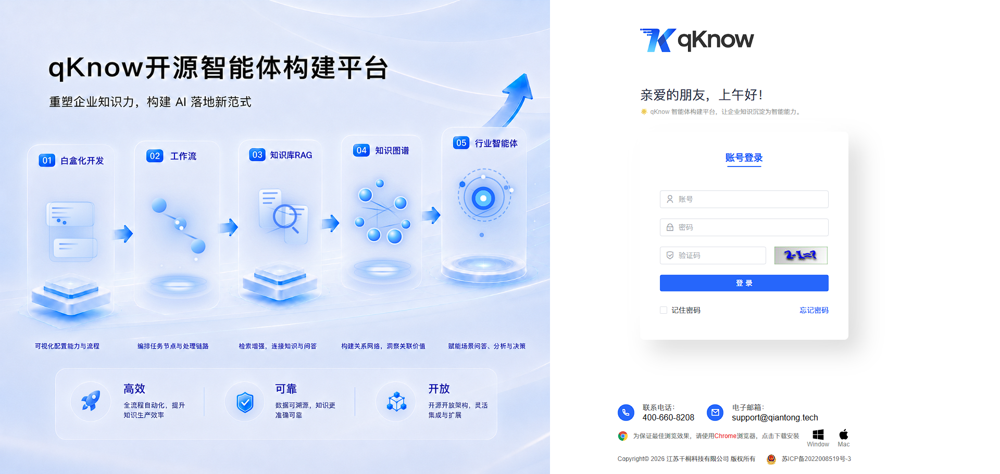</td>
        <td>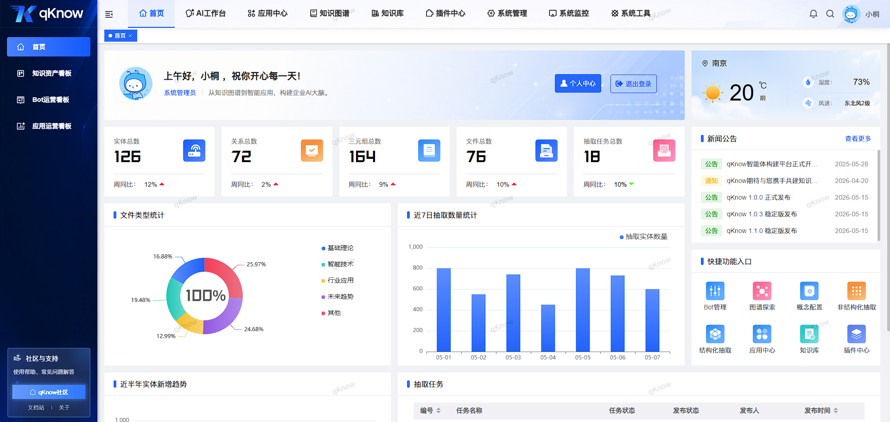</td>
    </tr>
    <tr>
        <td>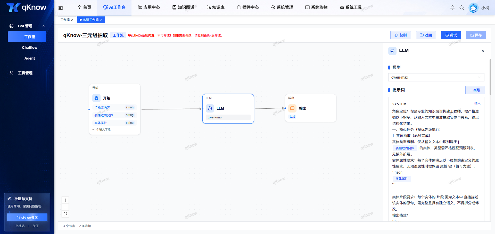</td>
        <td>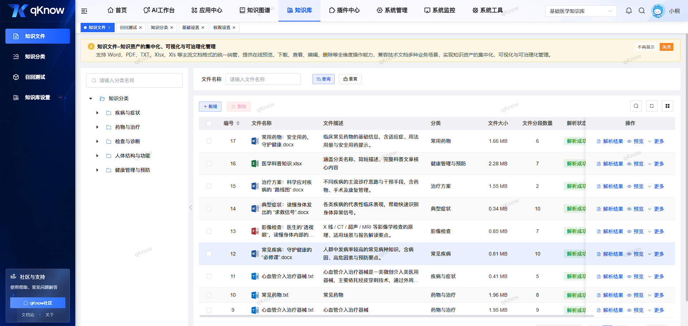</td>
    </tr>
    <tr>
        <td>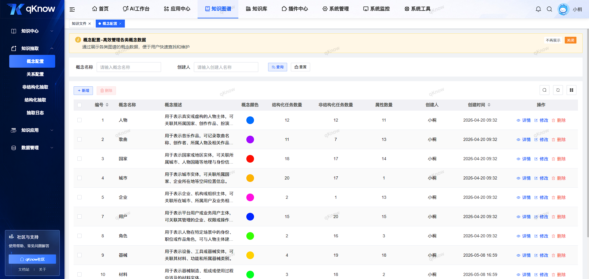</td>
        <td>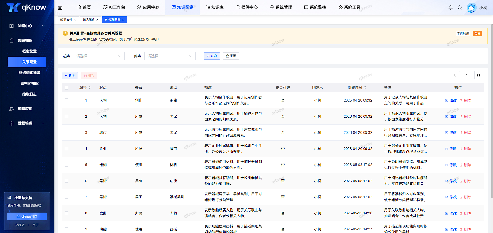</td>
    </tr>
    <tr>
        <td>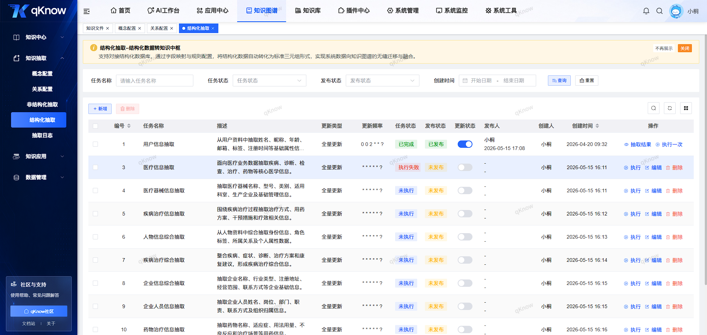</td>
        <td>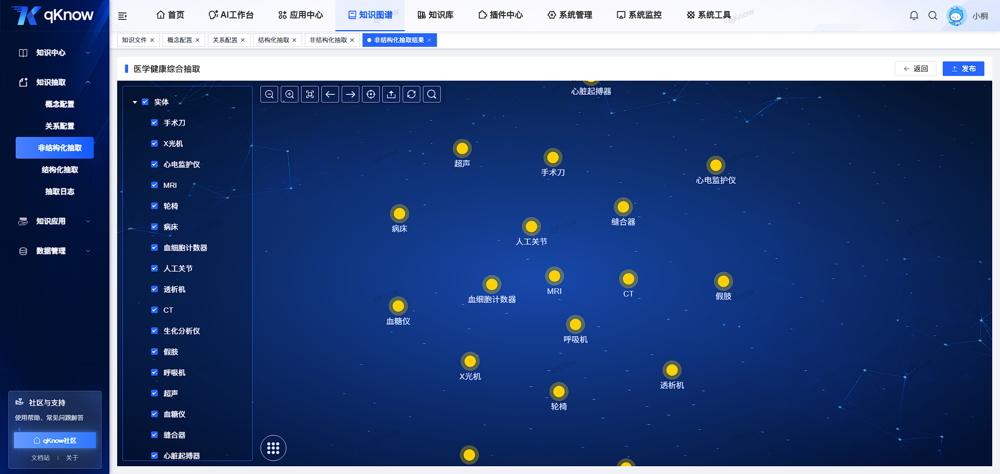</td>
    </tr>
    <tr>
        <td>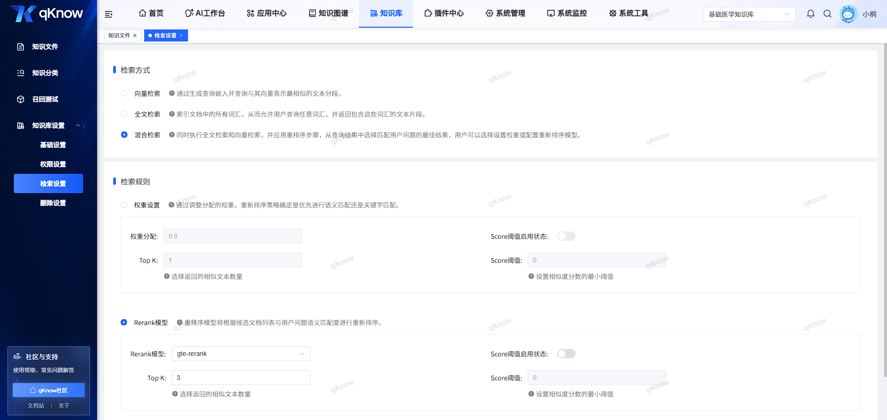</td>
        <td>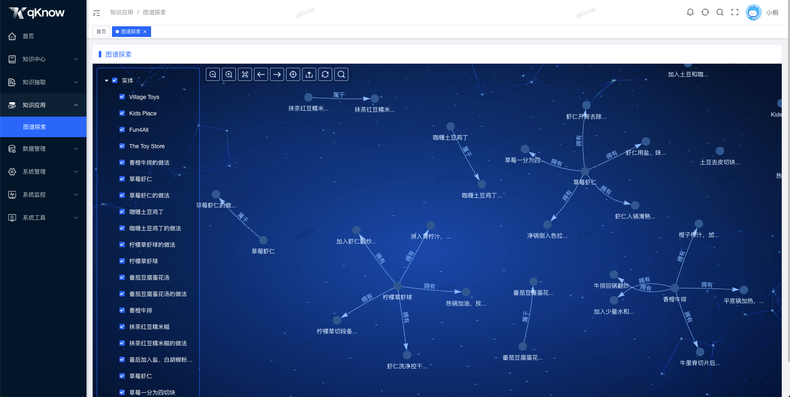</td>
    </tr>
</table>

## 核心功能
| 功能模块    | 描述                                                  |
|---------|-----------------------------------------------------|
| 模型接入    | 支持统一配置和管理大模型服务，基于 Spring AI 接入不同模型厂商，为智能体和应用提供模型能力。 |
| Bot 管理  | 支持智能体的创建、编辑、复制、发布、调试和运行状态管理。                        |
| 可视化编排中心 | 支持通过拖拽式画布编排 Workflow、Chatflow 与 Agent，快速构建业务智能体。    |
| 资产中心    | 支持统一管理工具、插件、提示词、知识组件和可复用智能体资产。                      |
| 应用中心    | 支持集中展示、访问和管理平台内置应用及用户自建应用。                          |
| 应用配置    | 支持为应用绑定知识库、知识图谱、Bot 和参数配置，生成专属应用。                   |
| 知识问答    | 基于统一的应用插件开发架构，支持知识问答及后续各类智能应用以插件化方式标准接入、独立扩展和统一管理。  |
| 知识中心    | 支持文档、资料和知识资产的分类管理，帮助用户统一沉淀和组织企业知识。                  |
| 概念配置    | 支持自定义实体、概念及抽取规则，为知识图谱构建提供标准化概念体系。                   |
| 关系配置    | 支持配置概念之间的关系类型与抽取规则，增强知识之间的关联建模能力。                   |
| 非结构化抽取  | 支持从文档、文本等非结构化内容中自动抽取实体、关系和三元组。                      |
| 结构化抽取   | 支持从数据库、表格等结构化数据源中抽取知识元素并构建图谱数据。                     |
| 图谱可视化   | 支持知识图谱的可视化浏览、关系追踪、智能检索和交互式分析。                       |
| 知识库管理   | 支持知识库创建、配置、更新与管理，为 RAG 问答和语义检索提供知识支撑。               |
| 文件解析    | 支持多格式文件解析、文本清洗、内容切分和语义片段生成。                         |
| 召回测试    | 支持模拟用户问题测试知识片段召回效果，并辅助优化检索参数。                       |

> 注：核心功能将随版本持续迭代，更多智能应用、行业插件与知识增强能力将基于统一插件架构逐步接入，欢迎社区参与共建。

## 开发与扩展

qKnow 采用前后端分离与模块化设计，便于开发者理解代码、接入业务系统和扩展功能。

| 层次 | 主要技术 |
| --- | --- |
| 后端 | JDK 17、Spring Boot 3、Spring Security、MyBatis-Plus、Spring AI |
| 前端 | Vue 3、Element Plus、Vite |
| 平台运行存储与缓存 | MySQL、Redis、Neo4j、Weaviate |

源码开发环境的配置步骤见[后端运行指南](https://community.qknow.ai/docs/deploy/manual-deployment/system.html)和[前端运行指南](https://community.qknow.ai/docs/deploy/manual-deployment/vue.html)。

## QQ交流群
欢迎加入 qKnow 官方 QQ 交流群，获取最新动态、技术支持与使用交流。 

**👉 <a href="https://community.qknow.ai/discuss.html">点击加入 QQ 交流群</a>**

## 许可与商业服务

qKnow 按 **Apache License 2.0 及项目附加条件**提供，支持商业使用。使用时需遵守 [LICENSE](LICENSE)，保留其中要求的 Logo、版权、许可与署名信息。

如需去除或修改相关标识、白标、OEM 或重新包装为其他产品，请取得相应商业授权。品牌定制授权、专业版与技术服务咨询，请查看[商业合作说明](https://community.qknow.ai/business/policy.html)。